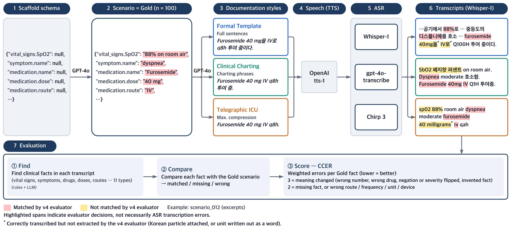

# Korean ICU Nursing Documentation Style Transfer Pipeline

*[English version here](README.md)*

본 프로젝트는 ICU 간호기록을 다양한 Documentation Register로 생성하고,
음성 합성(TTS) 및 음성 인식(STT)을 거쳐 임상 정보 보존 여부를 평가하기
위한 연구이다.

> ※ 본 프로젝트는 박사후/연구원 지원을 위한 개인 연구 프로젝트입니다.
> 실제 병원 EMR을 사용하지 않고 공개 Reference를 기반으로 Content Scaffold를 설계하였으며,
> 생성형 AI를 활용하여 ICU 간호기록 생성–음성 합성–음성 인식–Entity Evaluation–CCER까지의
> 전체 파이프라인을 구현하였습니다.



*연구 흐름도와 예시 1건(scenario_012). 강조 표시는 ASR 오류가 아니라 평가기의 판정을
나타내며, \*는 올바르게 전사됐지만 v4 평가기가 추출하지 못한 표현이다(§3.9 참고).*

**KOSMI 2026 추계학술대회 e-포스터(EP 8-6)**로 발표:
*Evaluating Clinical Information Preservation Across Documentation Styles in Korean-English
Code-Switched ICU Speech Recognition* — 포스터 PDF는
[awards-and-posters](https://github.com/jimin-the-ackerman/awards-and-posters)에 있다.

---

## 1. 연구 개요

한국 ICU 간호기록은 일반적인 한국어 문장과 다른 고유한 기록 체계
(Documentation Register)를 가진다. 동일한 임상 정보라도 완전한 문장형
서술(Formal Template), 한영 혼용 압축 기록(Clinical Charting), 극도로
압축된 실시간 기록(Telegraphic ICU) 등 서로 다른 방식으로 표현될 수 있으며,
이 표현 방식의 차이는 음성 인식(STT) 성능과 임상 정보 보존율에 서로 다른
영향을 미칠 수 있다.

본 연구는 다음을 전체 규모(100개 임상 시나리오 × 3개 Documentation Register
= 300개 샘플)로 구현하고 검증한다:

1. 동일한 임상 정보(Content Scaffold)를 3가지 Documentation Register로
   생성하는 Style-controlled Generation Pipeline
2. 생성된 간호기록을 음성으로 변환(TTS)하고 다시 텍스트로 전사(STT)하는 과정
3. 전사 결과에서 임상 정보 보존 여부를 Word Error Rate(WER), Entity-level
   Precision/Recall/F1, Clinical Critical Error Rate(CCER)로 평가하는 프레임워크
4. 사전 등록된 통계 분석 계획(Friedman/Wilcoxon/mixed-effects, WER-CCER
   상관, within-scenario disagreement, CCER 가중치 민감도 분석)
5. **Cross-ASR 강건성 점검**(2026년 11월): 같은 300개 음성을 세 ASR
   시스템(Whisper-1, gpt-4o-transcribe, Google Chirp 3)으로 전사하고 수정하지
   않은 v4 평가기로 채점(`docs/cross_asr_spec.md`)
6. **사후 평가기 민감도 분석(S1)**: 영어 임상 용어 뒤에 한국어 조사가 붙으면
   v4 추출기가 놓치는 문제에 대한 분석(`docs/cross_asr_spec.md` §13)

각 분석의 역할은 고정되어 있다. 9월 v4 Whisper-1 분석이 **주분석**,
Cross-ASR는 **강건성 점검**, S1은 주분석을 대체하지 않는 **사후 민감도 분석**이다.

평가 방법론은 결과와 무관하게 독립적으로 감사·수정된 4번의 문서화된 개정
(`docs/design_decisions.md`, `docs/taxonomy_audit.md`,
`docs/v4_style_invariant_extraction_spec.md`)을 거쳤다. 그중 가장 중요한
발견은 **closed-vocabulary 추출기가 영어 약어만 인식**하도록 설계돼있어,
임상 라벨을 한국어 완전 표기로 자주 렌더링하는 Formal Template이 실제
전사 정확도와 무관하게 구조적으로 불리하게 평가받고 있었다는 점이다.
아래 보고된 모든 결과는 이 편향을 제거한 최종 파이프라인(v4) 기준이다.

---

## 2. 전체 파이프라인

```
Reference Analysis
    -> Content Scaffold Schema
    -> GPT-4o: Structured Clinical Scenario Generation
    -> Style Controller
    -> GPT-4o: Style-controlled Documentation Generation
    -> OpenAI TTS: Speech Synthesis
    -> ASR: OpenAI Whisper-1(주분석); gpt-4o-transcribe, Google Chirp 3
       (Cross-ASR 강건성 점검)
    -> Entity Extraction (Closed-vocabulary / Open-vocabulary)
    -> Entity Matching & Error Type Classification
    -> Evaluation (WER / Entity-level P,R,F1 / CCER)
    -> Statistical Analysis (Friedman/Wilcoxon/Mixed-effects, WER-CCER
       association, within-scenario disagreement, weight sensitivity)
```

### 2.1 Content Scaffold Generation
공개된 표준 간호기록 서식, SBAR 예시, 임상 약어 목록을 분석하여
(`docs/reference_analysis.md`) Content Scaffold의 JSON Schema를 설계하였다
(`src/scaffold/scaffold_schema.py`). GPT-4o가 이 Schema를 따르는 임상
시나리오를 구조화된 JSON으로 생성한다(`src/scaffold/generate_scenarios.py`).
평가의 Gold Standard는 렌더링된 텍스트가 아니라 Content Scaffold 자체를
사용하여, Documentation Register 간 비교가 추출 단계의 차이로 왜곡되지
않도록 한다(`src/entity_extraction/scaffold_as_gold.py`;
`docs/design_decisions.md` §3 참고).

### 2.2 Style-controlled Documentation Generation
동일한 Content Scaffold를 Formal Template / Clinical Charting /
Telegraphic ICU 세 가지 스타일로 표현하도록 GPT-4o에 지시한다. 각 스타일의
규칙(문장 압축도, 한영 코드스위칭, 차팅형 서술어 등)은 Reference Analysis에
근거하여 설계되었다(`src/style_controller/style_controller.py`,
`src/generation/generate_notes.py`).

### 2.3 Speech Synthesis & Recognition
생성된 간호기록 텍스트를 OpenAI TTS로 음성화하고(`src/tts/synthesize_speech.py`),
OpenAI Whisper API로 다시 텍스트로 전사한다(`src/stt/transcribe.py`).
화자(voice)는 모든 샘플에 대해 단일하게 고정하여 통제변수로 유지한다.

Cross-ASR 강건성 점검에서는 같은 300개 음성을 `gpt-4o-transcribe`(OpenAI)와
`chirp_3`(Google Speech-to-Text V2)로 추가 전사했다. 프롬프트, 어휘 부스팅,
용어 목록은 쓰지 않았다(`src/cross_asr/transcribe.py`, `configs/cross_asr.yaml`).
Condition A(한국어 지정)가 주 조건이고, Condition B(언어 미지정/자동)는
탐색적 조건이다. CLOVA Speech는 시험 후 본 분석 전에 제외했다(한국어가
로마자로 출력됨; `docs/cross_asr_spec.md` §11.1).

### 2.4 Entity Extraction
전사된 텍스트에서 임상 정보를 두 갈래로 추출하며, 결과와 무관하게 독립
확정된 11개 entity type을 다룬다(`docs/taxonomy_audit.md` §5):

- **Closed-vocabulary Entity** (Route, Frequency, Device, Dose, Vital Sign):
  Reference Analysis에서 확인된 표준 약어 목록을 Dictionary/정규식으로
  규칙 기반 추출한다(`src/entity_extraction/closed_vocab_extractor.py`).
  v4부터 이 추출기는 **style-invariant**하다 — 영어 약어만이 아니라,
  영어 전체 표기·한국어 전체 표기·소수의 관행적 음차 표현까지 `surface
  form → canonical concept/value → 비교` 구조로 인식한다. `medication_dose`
  추출에는 entity ownership hierarchy(후보 탐지 → vital_sign/intake_output
  등 더 구체적인 소유권을 가진 값 배제 → medication-administration 문맥
  확인)를 추가로 적용해, 무관한 숫자를 약물 용량으로 잘못 귀속시키는 것을
  방지한다. 전체 스펙과 감사 과정은
  `docs/v4_style_invariant_extraction_spec.md` 참고.
- **Open-vocabulary Entity** (Symptom, Clinical Status, Medication Identity,
  Intervention, Intake/Output, Notification): 표현이 자유로워 규칙으로
  포착할 수 없으므로, Claude의 Structured Output으로 추출한다
  (`src/entity_extraction/open_vocab_extractor.py`).

### 2.5 Entity Matching & Error Classification
Whisper 전사문에서 추출된 Entity를 Gold Standard(Content Scaffold)와
대조하여 각 임상 정보의 보존 여부를 판정한다.

- Closed-vocabulary: 정규화된 값을 규칙 기반으로 비교한다
  (`src/matching/entity_matcher.py`).
- Open-vocabulary: Claude가 Gold와 Whisper entity 목록을 함께 검토하여
  의미 기반 매칭을 수행하며, medication identity에는 ISMP Confused Drug
  Names 목록에 근거한 더 엄격한 look-alike/sound-alike 안전장치를 적용한다
  (`src/matching/semantic_matcher.py`).

매칭 결과는 Matched / Omission / Numeric Error / Route Error / Frequency
Error / Medication Identity Error / Negation Flip / Severity Shift /
Hallucination 등으로 분류된다.

### 2.6 Evaluation
파이프라인 결과를 세 가지 지표로 평가한다:

- **WER** (`src/evaluation/wer_eval.py`): Gold Transcript와 Whisper
  Transcript 간 전사 정확도. Raw/Normalized(대소문자·구두점 무관) 값을
  모두 보고한다.
- **Entity-level Precision/Recall/F1** (`src/evaluation/entity_eval.py`):
  Content Scaffold 대비 Whisper 결과물의 임상 정보 보존율.
- **Clinical Critical Error Rate (CCER)** (`src/evaluation/ccer_eval.py`):
  각 오류 유형을 잠재적 임상 위험도에 따라 가중치를 부여해 정규화한 점수.
  가중치 체계는 NCC MERP의 환자안전 철학(그리고 medication identity에
  한해 ISMP Confused Drug Names 목록)을 개념적으로 참고해 연구자가 3단계
  (상/중/하)로 설계했으며, 이 가중치 선택 자체를 사전 등록한 5개 대안
  체계로 stress-test했다(아래 §3.5 참고).

### 2.7 Statistical Analysis
사전 등록된 분석 계획(`docs/statistical_analysis_plan.md`, 실행 전
확정)은 다음을 포함한다: Kendall's W를 동반한 Friedman test, Holm 보정
Wilcoxon pairwise 비교, mixed-effects model
(`src/analysis/statistical_tests.py`); scenario-level cluster-bootstrap
WER-CCER Spearman 상관(`src/analysis/sap1_wer_ccer_spearman.py`);
within-scenario 순위 불일치(`src/analysis/sap2_within_scenario_disagreement.py`);
5개 사전 지정 scheme에 대한 CCER 가중치 민감도 분석
(`src/analysis/sap3_weight_sensitivity.py`); entity_type별 오류율
(`src/analysis/sap4_error_profile_final.py`).

---

## 3. 결과 (최종, v4, n=100 시나리오 / 300 샘플)

전체 결과: [`results/full_100_v4/`](results/full_100_v4/).

### 3.1 Word Error Rate (normalized)

| Documentation Register | Mean WER |
|---|---|
| Formal Template | 0.3038 |
| Clinical Charting | 0.4517 |
| Telegraphic ICU | 0.5640 |

### 3.2 Entity-level Evaluation

| Documentation Register | Precision | Recall | F1 |
|---|---|---|---|
| Formal Template | 0.8432 | 0.6728 | 0.7484 |
| Clinical Charting | 0.7665 | 0.5406 | 0.6341 |
| Telegraphic ICU | 0.7995 | 0.4933 | 0.6101 |

### 3.3 Clinical Critical Error Rate

| Documentation Register | CCER (낮을수록 좋음) |
|---|---|
| Formal Template | 0.8417 |
| Clinical Charting | 1.1682 |
| Telegraphic ICU | 1.2134 |

### 3.4 통계적 유의성

Friedman test: χ² = 78.12, Kendall's W = 0.391, p = 1.09 × 10⁻¹⁷.
Holm 보정 Wilcoxon signed-rank: Formal Template은 나머지 두 스타일과
각각 유의하게 다름(p_holm ≈ 1.3 × 10⁻¹¹, 3.3 × 10⁻¹²); Clinical Charting과
Telegraphic ICU는 서로 유의하게 다르지 않음(p_holm = 0.217). Mixed-effects
model(`CCER ~ style + (1|scenario)`)도 두 스타일 계수 모두 p < 0.0001로
유의함을 확인했다. Formal Template이 CCER 최선이라는 결론은 사전 등록한
5개 CCER 가중치 scheme 전부에서 유지되었다(`docs/statistical_analysis_plan.md`
§3).

### 3.5 핵심 발견

WER, Entity-level F1, **그리고** CCER **전부**에서 이제 Formal Template이
**최선**, Telegraphic ICU가 최악으로 나타난다. 이는 이 파이프라인의 이전
(방법론적으로 혼입이 있었던) 버전(v3)의 정반대 결론 — Formal Template이
WER 기준 최선이지만 CCER 기준 *최악*이라는, "완전한 문장형 서술이 원시
전사 정확도는 높이지만 Whisper가 임상 정보를 더 많이 놓치게 만든다"는
결론 — 을 뒤집는 극적인 결과다.

이 이전의 "역전" 발견은 **evaluator 전체 감사를 통과하지 못했다.** 실제
임상 정보 손실과 무관하게 Formal Template의 오류 건수를 부풀린 두 가지
독립적인 구조적 편향이 발견됐다:

1. **스타일 의존적 추출 편향**: closed-vocabulary 추출기가 영어 약어
   (`BP`, `HR`, `IV`, `q4h` 등)만 인식했다. Formal Template은 같은 임상
   사실을 한국어 완전 표기(`혈압`, `심박수`, `정맥으로`, `매 4시간마다`)로
   자주 렌더링하는데, Whisper가 이를 정확히 전사했는지와 무관하게
   추출기가 아예 인식을 못 했다. 이 하나만으로도 Formal Template의
   활력징후 인식률이 수정 후 0%→100%로 바뀌었다.
2. **Gold/Whisper 값 형식 비대칭**: (1)을 고친 후에도, Content Scaffold의
   Gold 값은 원본 단위를 그대로 유지(예: `"120 bpm"`)하는 반면 Whisper
   쪽 추출기는 항상 순수 숫자(`"120"`)만 포착했다. 이 때문에 Whisper가
   숫자를 완벽하게 전사했어도 가짜 "numeric error"가 발생했다 — 파이프라인
   최초 버전부터 있던 버그였는데, (1)을 고쳐 Formal Template의 라벨이
   처음으로 대량 매칭되기 전까지는 드러나지 않았다.

둘 다 원하는 결과에 맞춰 땜질한 게 아니라 실제 데이터 검증(회복률, 비파괴
확인, false-positive 스캔)을 거쳐 감사·수정했다. 전체 스펙과 근거,
감사 과정은 `docs/v4_style_invariant_extraction_spec.md`에 있다. 편향을
제거한 올바른 결론은, 이 파일럿에서 WER·Entity-level F1·CCER이 대체로
일관된다는 것이다 — 더 문법적이고 완전하게 풀어쓴 기록은 Whisper가
정확하게 전사하기도 쉽고, 임상 정보 보존에도 더 낫다. 영어 전용
evaluator가 내렸을 결론과는 정반대다.

따라서 이 프로젝트의 방법론적 기여는 세 스타일의 구체적인 순위 자체보다,
**임상적으로 설계된 평가 지표(CCER)를 만드는 것만으로는 evaluator 편향에서
자유롭다는 보장이 되지 않으며, 그 지표를 뒷받침하는 entity extraction
계층도 지표 자체와 동일한 엄밀함으로 감사돼야 한다**는 것을 보여주는
데 있다.

### 3.6 Macro-CCER — Formal Template의 우위는 균일한가?

위의 primary(micro-averaged) CCER은 Gold Standard 내 등장 빈도에 따라
각 entity type을 가중한다 — 활력징후는 시나리오당 5회 등장해 전체
Gold entity의 약 35%(1415개 중 500개)를 차지한다. Aggregate 결과를
**본 뒤에** 추가한 사후(post-hoc) 민감도 분석(`docs/statistical_analysis_plan.md`
에 그렇게 명시)으로, entity type 11개에 빈도와 무관하게 동일한
가중치를 부여하는 **macro-CCER**을 계산해 Formal Template의 우위가
이 빈도 불균형만의 인공물인지 확인했다.

| Register | Micro-CCER | Macro-CCER | 승리한 entity type 수(11개 중) |
|---|---|---|---|
| Formal Template | 0.8417 | **0.8021** | **7** |
| Clinical Charting | 1.1682 | 0.8469 | 3 |
| Telegraphic ICU | 1.2134 | 0.9563 | 1 |

Macro-averaging 하에서도 순위는 유지됐다 — 즉 Formal Template의 우위가
순수히 활력징후 빈도만의 인공물은 아니다. 하지만 격차는 상당히 좁아졌고
(micro 기준 약 0.33~0.37 격차 → macro 기준 약 0.04~0.15 격차), 그
우위는 **균일하지 않다**: Formal Template은 11개 중 7개
entity type에서 entity type별 CCER이 가장 낮았지만(그중 `medication_identity`는
Clinical Charting과 동률; `vital_sign`에서는 큰 격차로), `device`, `dose`,
`route` — 투약 및 물리적 장비를 서술하는 entity type — 에서는 오히려
Clinical Charting에 **뒤졌고**, `symptom`에서는 가장 높았다.
이 발견이 3.7절의 탐색적 후속 실험을 직접 동기부여했다. 이후 `dose`/`route`
격차의 대부분은 평가기 효과였던 것으로 확인됐다(3.9절).

### 3.7 탐색적 후속 실험: Entity-Informed Hybrid Register

위의 entity-의존적 패턴은 자연스러운 설계 질문을 낳는다: 하나의
register를 노트 전체에 균일하게 적용하는 대신, 개별 임상 사실 단위로
register를 조합하면 각각의 강점을 회복할 수 있을까? 이 질문 — 그리고
이를 검증하기 위해 만든 Hybrid register — 는 primary 실험 결과를
관찰한 뒤 동기부여됐으므로, 처음부터 끝까지 **탐색적(exploratory)
후속 실험**으로 취급하며 확증적 검정으로 다루지 않는다(전체 설계,
사전 등록 가설, manipulation-check 계획을 Hybrid 데이터 생성
**이전에** 확정: `docs/hybrid_followup_spec.md`).

**설계**: Hybrid는 활력징후·증상·임상상태·처치·통보·섭취배설은
Formal Template 방식으로, 투약 사건(약물명+용량+투여경로+투여빈도,
기존 Medication Expression Rule에 따라 하나의 문법적 단위로 렌더링)과
장치/산소공급은 Clinical Charting 방식으로 렌더링하며, Content
Scaffold의 자연스러운 정보 순서를 엄격히 유지한다(Formal 표현
사실을 앞에, Clinical 표현 사실을 뒤에 배치했던 초기 설계안은
register와 정보 순서가 뒤섞이는 confound를 만든다는 이유로 명시적으로
기각됐다). Frequency를 Clinical block에 포함시킨 건 문법적 필요성
때문이지, Clinical이 frequency 단독 항목에서 더 나아서가 아니다
(실제로는 그 반대: 0.687 vs. 1.192).

음성합성 이전에 실행한 결정론적 **manipulation check**(추가 API
호출 없음)는 생성된 Hybrid 노트 100개 전부에서 의도한 register가
실제로 구현됐는지 확인했다: route/frequency/device 344건 중
314건(91.3%)이 영어 약어 형태로, 활력징후 488건 중 488건(100.0%)이
한국어 완전 표기로 렌더링됨을 확인했다. 이 결과는 있는 그대로
기록했고 생성 프롬프트를 재조정하는 근거로 쓰지 않았다.

**결과**(n=100 시나리오, primary 실험과 동일한 원본 scaffold 기준):

| Register | nWER | Entity F1 | Micro-CCER | Macro-CCER |
|---|---|---|---|---|
| **Hybrid** | 0.3342 | **0.8084** | **0.6664** | **0.6340** |
| Formal Template | 0.3038 | 0.7484 | 0.8417 | 0.8021 |
| Clinical Charting | 0.4517 | 0.6341 | 1.1682 | 0.8469 |
| Telegraphic ICU | 0.5640 | 0.6101 | 1.2134 | 0.9563 |

Hybrid는 4개 register 중 Entity F1, micro-CCER, macro-CCER 전부에서
최선을 기록했다 — Formal Template 대비 micro-CCER이 21% 감소(0.842→
0.666)했으며, 이는 (두 조건이 같은 100개 scaffold를 공유하므로 primary
inferential comparison으로 쓴) Formal Template과의 scenario 단위
쌍체 Wilcoxon signed-rank test로 확인됐다: **W = 1070.00, p = 7.07 ×
10⁻⁶**(100개 시나리오 중 68개 개선, 27개 악화, 5개 동률).

Entity-level 결과는 애초 동기가 됐던 패턴을 확인해줬다: `device`,
`dose`, `route`가 Formal Template 대비 실질적으로 개선되어 Clinical
Charting 수준으로(dose는 그 이상으로) 이동했다. 다만 `vital_sign`을
포함한 여러 Formal-block entity type도 렌더링 규칙이 **바뀌지 않았음
에도** 함께 개선됐는데, 이는 전체 개선분의 일부가 register 재설계
자체가 아니라 TTS/STT의 통상적인 run-to-run 변동을 반영할 가능성을
시사한다 — 렌더링 규칙이 실제로 바뀐 `device`/`dose`/`route`에는
이 유보가 적용되지 않는다. 가장 중요한 건, **`frequency`가 Hybrid
하에서 원본 두 register 어느 쪽보다도 악화**됐다는 점이다(0.687→
1.343) — Clinical Charting 자체의 이미 더 나빴던 frequency 성능
(1.192)보다도 나쁘다. 이는 정확히 사전에 문서화했던 위험(약물명/
용량/투여경로/투여빈도라는 언어적으로 결합된 사실들을 두 개의 다른
register에 억지로 분산시키는 것)이 실현된 것이다. 이를 정직하고
유용한 negative finding으로 보고한다: entity별로 서술적으로 관찰된
장점들이 자동으로 균일하게 우수한 mixed-register 노트로 합성되지는
않는다.

> **갱신(2026년 11월).** 사후 조사 처리 민감도 분석(3.9절)에서는 Hybrid의
> Formal Template 대비 우위가 나타나지 않는다(micro-CCER 0.674 vs 0.675,
> macro-CCER 0.645 vs 0.598; pooled 값, 검정 없음). Hybrid는 약물 정보를
> Clinical 스타일("40 mg IV")로 써서, Formal Template의 "40mg을", "IV로"에만
> 생기던 추출 누락을 피해 갔다. 따라서 Hybrid 개선분의 대부분은 전사가 좋아진
> 효과보다 평가기 효과였을 가능성이 크다.

### 3.8 Cross-ASR 강건성 점검 (2026년 11월)

같은 300개 음성, 같은 scaffold, 수정하지 않은 v4 평가기를 사용했다. 세 시스템은
같은 실행에서 평가했으며, 9월 Whisper-1 전사문도 다시 평가했다(Condition A,
한국어 지정, n = 100 시나리오). 프로토콜과 실행 기록: `docs/cross_asr_spec.md`;
결과: `results/cross_asr/`.

| ASR | Style | nWER | Entity F1 | Micro-CCER | Macro-CCER |
|---|---|---|---|---|---|
| Whisper-1\* | Formal | **0.304** | **0.750** | **0.837** | **0.785** |
| | Clinical | 0.452 | 0.627 | 1.180 | 0.864 |
| | Telegraphic | 0.564 | 0.617 | 1.194 | 0.917 |
| gpt-4o-transcribe | Formal | **0.246** | **0.822** | **0.636** | 0.671 |
| | Clinical | 0.277 | 0.722 | 0.925 | 0.643 |
| | Telegraphic | 0.360 | 0.770 | 0.796 | **0.559** |
| Chirp 3 | Formal | **0.155** | **0.813** | **0.672** | 0.685 |
| | Clinical | 0.243 | 0.745 | 0.845 | **0.560** |
| | Telegraphic | 0.305 | 0.768 | 0.785 | 0.582 |

\*주분석과 같은 전사문을 2026년 11월에 다시 평가한 값이다. pooled CCER은 9월
실행과 최대 0.02 차이였고 스타일 순위는 같았다(평가 LLM의 실행 간 변동;
temperature 미설정). 굵은 글씨 = 시스템 내 최선값.

| ASR (v4, n = 100) | Friedman chi-sq (W) | F vs C (Holm p) | F vs T (Holm p) | C vs T (Holm p) |
|---|---|---|---|---|
| Whisper-1\* | 75.7 (0.38) | 9.8e-12 | 5.0e-12 | 0.72 |
| gpt-4o-transcribe | 35.5 (0.18) | 6.6e-9 | 0.0017 | 0.0095 (T가 낮음) |
| Chirp 3 | 8.1 (0.04) | 5.9e-4 | **0.066** | 0.24 |

- **세 시스템 모두에서 Formal Template의 nWER가 가장 낮고, Entity F1이 가장
  높고, micro-CCER이 가장 낮았다.** Clinical Charting과 Telegraphic ICU의
  순서는 시스템마다 달랐다.
- v4에서 Chirp 3의 Formal vs Telegraphic 차이는 유의하지 않았고(Holm p = 0.066),
  **macro-CCER에서는 gpt-4o-transcribe와 Chirp 3에서 Formal이 3위**였다.
  이유는 3.9절에 있다.
- Condition B(언어 미지정, 탐색적)에서도 micro-CCER 양상은 같았다(세 시스템
  모두 Formal이 가장 낮음).
- TTS 결함이 의심되는 두 시나리오(007, 063; `docs/cross_asr_spec.md` §12.3)를
  빼도 결론은 바뀌지 않는다.

### 3.9 사후 평가기 민감도 분석 S1: 한국어 조사 결합

Cross-ASR 연구의 표기 진단에서, 올바르게 전사된 영어 용어 뒤에 한국어 조사가
붙은 표현 — 예: "40mg**을**", "IV**로**", "nasal cannula**를**" — 을 v4
closed-vocabulary 추출기가 놓친다는 것이 확인됐다. 파이썬의 `\b`가 한글을
단어 문자로 취급하기 때문이다. S1은 closed-vocabulary 패턴 41개의 단어 경계
조건만 바꿔 한국어 조사 27개가 뒤에 와도 인정한다(조사는 추출 값에 포함되지
않는다). open-vocabulary 매칭은 그대로 재사용한다. 결과를 본 뒤 설계했으므로
**사후 민감도 분석**으로 보고하며, v4가 주분석으로 유지된다
(`docs/cross_asr_spec.md` §13, §13.1; API 호출 없음).

| ASR | Formal micro-CCER (v4 -> S1) | Formal macro-CCER (v4 -> S1) | Macro 순위 (v4 -> S1) |
|---|---|---|---|
| Whisper-1 (9월, 주분석 실행) | 0.842 -> 0.675 | 0.802 -> 0.598 | F < C < T -> F < C < T |
| Whisper-1\* (11월) | 0.837 -> 0.670 | 0.785 -> 0.581 | F < C < T -> F < C < T |
| gpt-4o-transcribe | 0.636 -> 0.466 | 0.671 -> 0.455 | T < C < **F** -> **F** < T < C |
| Chirp 3 | 0.672 -> 0.455 | 0.685 -> 0.419 | C < T < **F** -> **F** < C < T |

- S1이 바꾼 것은 **Formal Template뿐**이다. Clinical Charting과 Telegraphic
  ICU는 0.005 이하로 변했다(micro, macro 모두).
- S1에서는 모든 시스템에서 Formal이 나머지 두 스타일과 유의하게 달랐고
  (Holm p < 1e-8), Kendall's W가 커졌다(9월 Whisper-1 0.39 -> 0.51,
  gpt-4o-transcribe 0.18 -> 0.40, Chirp 3 0.04 -> 0.33).
- Entity 수준(9월 Whisper-1, Formal v4 -> S1; 괄호는 Clinical Charting):
  `dose` 1.820 -> **0.640**(1.040; 순위 역전), `route` 1.770 -> 1.090(1.010),
  `device` 1.618 -> 1.309(0.890; 남은 격차는 "폴리 캐테터" 같은 한국어 음차
  표기 때문일 가능성이 크며, 이는 S1 범위 밖이다).
- 수동 검토(Condition A; 전사문과 scaffold 기준, 음성 미청취): omission ->
  matched로 바뀐 기록을 층화 추출한 30건은 모두 올바른 매칭이었다. 부작용 감사
  40건에서는 잔여 평가기 산물 24건이 확인됐다(예: IV 중복 언급, 산소 유량이나
  수액량을 용량으로 읽음). **따라서 S1 값에도 잔여 평가기 산물이 남아 있으며,
  보정된 값으로 보고하지 않는다.**
- S1의 macro-CCER과 Hybrid S1 확인은 KOSMI 포스터를 위해 추가 계산했다
  (`src/cross_asr/kosmi2026_tables.py`, `results/cross_asr/kosmi2026_tables/`,
  명세 §13.2).

### 3.10 종합 결론

1. **스타일 결과.** 세 ASR 시스템 모두에서 Formal Template의 micro-CCER이
   가장 낮았다(nWER도 가장 낮고 Entity F1은 가장 높음). 이 우위는 사후 조사
   보정 뒤에도 유지됐고 오히려 커졌다.
2. **평가기 결과.** 평가기가 한국어·영어 혼용 표현을 어떻게 처리하느냐가
   결론을 두 번 바꿨다. v3 -> v4 재설계(한국어 라벨, 값 형식)는 전체 스타일
   순위를 뒤집었고(3.5절), 조사 처리(S1)는 `dose` 순위, 두 시스템의
   macro-CCER 순위, Hybrid의 우위를 바꿨다. 한국어·영어 코드 스위칭 ASR을
   임상 가중치로 평가하려면 스타일에 영향받지 않는 추출과, 사람의 판정으로
   검증한 평가기가 필요하다.

**한계.** LLM이 생성한 기록과 단일 화자 TTS 음성을 사용했으며 실제 ICU 음성이
아니다. entity taxonomy와 중증도 가중치는 외부 자료에 근거했고 의료진 검토를
거치지 않았다. 평가기의 판정(LLM 기반 open-vocabulary 매칭 포함)을 사람의
판정으로 검증하지 않았다.

**향후 연구.** 의료진이 검토한 시나리오·entity 정의·가중치와 실제 ICU 음성으로
검증 → 사람의 판정으로 검증한 코드 스위칭 대응 평가기 → CCER 정보를 반영한
ASR 파인튜닝.

---

## 4. Repository Structure

```
korean-icu-ccer-pilot/
├── configs/
│   └── config.yaml              # 실험 설정 (n_scenarios, results_dir 등)
├── docs/
│   ├── reference_analysis.md    # Reference 자료 분석
│   ├── design_decisions.md      # 구현 중 설계 변경 기록
│   ├── limitations.md           # 연구의 한계
│   ├── taxonomy_audit.md        # v3: 독립적 CCER taxonomy 감사 및 확정
│   ├── v4_style_invariant_extraction_spec.md  # v4: 스타일 편향 감사·스펙·확정
│   ├── statistical_analysis_plan.md           # 사전 등록 SAP (확정본)
│   ├── hybrid_followup_spec.md                # 탐색적 Hybrid register 설계(확정본)
│   ├── cross_asr_spec.md                      # Cross-ASR 프로토콜, 실행 기록, S1(§13)
│   ├── figures/research_flow.png              # 연구 흐름도 (KOSMI 2026)
│   └── full_run_execution_order.md            # 확장 실행 순서 고정 문서
├── data/
│   ├── scenarios/                # Content Scaffold (GPT-4o 생성)
│   ├── generated_text/           # 스타일별 Gold Transcript(Hybrid 포함)
│   ├── audio/                    # TTS 음성 파일 (git 추적 안 함)
│   ├── stt_transcripts/          # Whisper 전사 결과
│   ├── entities/                 # Entity 추출/매칭 결과
│   └── cross_asr/<condition>/    # Cross-ASR 전사문, entity 결과, 실행 로그
├── src/
│   ├── pipeline_utils.py          # Skip-by-default 안전장치 (RunLog, --overwrite)
│   ├── scaffold/                  # Content Scaffold schema 및 생성
│   ├── style_controller/          # Documentation Register 규칙(Hybrid 포함)
│   ├── generation/                # GPT-4o 문서 생성
│   ├── tts/                       # 음성 합성
│   ├── stt/                       # 음성 인식
│   ├── entity_extraction/         # Closed/open-vocabulary 추출
│   ├── matching/                  # Entity 매칭, semantic matching
│   ├── evaluation/                # WER, entity evaluation, CCER
│   ├── analysis/                  # Error profile, 통계 검정, SAP 1-5,
│   │                                 hybrid_followup, hybrid_manipulation_check
│   └── cross_asr/                 # Cross-ASR 전사, 평가, 분석, 표기 진단, S1,
│                                     KOSMI 표 재계산
├── results/
│   ├── pilot_15/                  # v1/v2/v3 체크포인트(15샘플 파일럿, 보존)
│   ├── full_50/                   # 50-scenario 체크포인트(보존)
│   ├── full_100/                  # v3(v4 수정 전) 100-scenario 체크포인트(보존)
│   ├── full_100_v4/               # 최종 결과, 3-register primary 분석(편향 보정)
│   ├── hybrid_followup/           # 탐색적 Hybrid register 결과(full_100_v4/와 분리)
│   ├── cross_asr/                 # Cross-ASR 분석(analysis_prelim_condA = 최종), 표기
│   │                                 진단, sensitivity_ko_particle(S1), kosmi2026_tables
│   └── _env/                      # Cross-ASR 실행 환경 기록
└── tests/                          # 유닛 테스트
```

---

## 5. 재현 방법

### 5.1 환경 설정

```bash
python3 -m venv venv
source venv/bin/activate
pip install -r requirements.txt
cp .env.example .env   # OPENAI_API_KEY, ANTHROPIC_API_KEY 입력
```

### 5.2 전체 파이프라인 실행 순서

모든 생성/추출/매칭 스크립트는 기본적으로 idempotent하다 — 이미 결과가
있는 샘플은 자동으로 건너뛰고, 없는 것만 처리한다(`src/pipeline_utils.py`).
강제로 다시 만들려면 `--overwrite`를 붙이면 된다. 덕분에 규모 확장(5→50→100
시나리오)을 이미 계산된 결과를 훼손할 위험 없이 안전하게 진행할 수 있다 —
이 프로젝트가 실제로 확장할 때 쓴 전체 체크리스트는
`docs/full_run_execution_order.md` 참고.

```bash
# 1. Content Scaffold 생성 (GPT-4o)
python3 -m src.scaffold.generate_scenarios

# 2. 스타일별 문서 생성 (GPT-4o)
python3 -m src.generation.generate_notes

# 3. 음성 합성 (OpenAI TTS)
python3 -m src.tts.synthesize_speech

# 4. 음성 인식 (OpenAI Whisper)
python3 -m src.stt.transcribe

# 5. Entity 추출 (closed-vocab은 정규식이라 API 불필요, open-vocab은 Claude 호출)
python3 -m src.entity_extraction.run_closed_vocab_extraction
python3 -m src.entity_extraction.run_open_vocab_extraction

# 6. Entity 매칭 (closed-vocab은 규칙 기반, API 불필요; open-vocab은 Claude)
python3 -m src.matching.run_closed_vocab_matching
python3 -m src.matching.run_semantic_matching

# 7. 평가 (WER, Entity-level P/R/F1, CCER, Error Profile) - API 불필요
python3 -m src.evaluation.wer_eval
python3 -m src.evaluation.entity_eval
python3 -m src.evaluation.ccer_eval
python3 -m src.analysis.error_profile --output-dir results/full_100_v4

# 8. 통계 분석 (docs/statistical_analysis_plan.md 기준) - API 불필요
python3 -m src.analysis.statistical_tests --results-dir results/full_100_v4
python3 -m src.analysis.sap1_wer_ccer_spearman --results-dir results/full_100_v4
python3 -m src.analysis.sap2_within_scenario_disagreement --results-dir results/full_100_v4
python3 -m src.analysis.sap3_weight_sensitivity --output-dir results/full_100_v4
python3 -m src.analysis.sap4_error_profile_final --output-dir results/full_100_v4
```

### 5.3 규모 확장

`configs/config.yaml`의 `experiment.n_scenarios`를 바꾸고(결과를 별도
폴더에 보존하고 싶으면 `paths.results_dir`도 함께), 위와 동일한 순서로
재실행하면 된다. 모든 단계가 기본적으로 이미 있는 결과를 건너뛰므로,
기존에 계산된 시나리오(예: 처음 100개)는 전혀 손대지 않고 새로 추가된
것만 처리된다 — 별도 코드 수정이 필요 없다. 이 프로젝트가 실제로
5→50→100 시나리오로 확장할 때 쓴 정확한 체크리스트(사전 점검, 무결성
확인, 하지 않을 것 목록 포함)는 `docs/full_run_execution_order.md` 참고.

### 5.4 Cross-ASR 강건성 점검과 S1

설정은 `configs/cross_asr.yaml`에 있다. 전사에는 `OPENAI_API_KEY`와 Google
Application Default Credentials(Chirp 3)가, 평가에는 `ANTHROPIC_API_KEY`가
필요하다. 정확한 인자, 실행 순서, 중단 규칙은 `docs/cross_asr_spec.md`(§3-13)와
각 모듈의 `--help`에 있다.

```bash
python3 -m src.cross_asr.manifest              # 음성 manifest와 파일럿 세트
python3 -m src.cross_asr.transcribe            # 조건별 전사 (API)
python3 -m src.cross_asr.evaluate              # 조건별 CCER v4 평가 (API)
python3 -m src.cross_asr.analysis              # pooled CCER, Delta, Friedman/Wilcoxon (API 불필요)
python3 -m src.cross_asr.notation_diagnostics  # 표기 집계와 사례 검토 (API 불필요)
python3 -m src.cross_asr.sensitivity_ko_particle --run   # S1 (API 불필요)
python3 -m src.cross_asr.kosmi2026_tables      # KOSMI 포스터 표 (API 불필요)
```

### 5.5 테스트

```bash
pytest tests/ -q
```

---

## 6. 관련 문서

- [`docs/reference_analysis.md`](docs/reference_analysis.md): Content
  Scaffold Schema 및 Style Controller 규칙의 근거가 된 Reference 자료 분석
- [`docs/design_decisions.md`](docs/design_decisions.md): 원안 대비 구현
  중 변경된 설계 결정 기록
- [`docs/limitations.md`](docs/limitations.md): 연구의 한계, 의도적으로
  남겨둔 잔여(스타일 편향과 무관한) 파싱 공백 포함
- [`docs/taxonomy_audit.md`](docs/taxonomy_audit.md): v3 — 11개 CCER
  entity taxonomy에 대한 독립적·결과-무관 감사 및 확정
- [`docs/v4_style_invariant_extraction_spec.md`](docs/v4_style_invariant_extraction_spec.md):
  v4 — 위 §3.5에서 설명한 style-invariant closed-vocabulary 추출 수정의
  감사·스펙·확정 문서
- [`docs/statistical_analysis_plan.md`](docs/statistical_analysis_plan.md):
  사전 등록된 통계 분석 계획(실행 전 확정), §3.6에서 설명한 사후
  추가된 Macro-CCER 분석 포함
- [`docs/hybrid_followup_spec.md`](docs/hybrid_followup_spec.md):
  §3.7에서 설명한 탐색적 Hybrid register의 설계 명세(block mapping,
  사전 등록 가설, manipulation-check 계획) — Hybrid 데이터 생성
  이전에 확정
- [`docs/full_run_execution_order.md`](docs/full_run_execution_order.md):
  5→100 시나리오 확장 시 이미 계산된 결과를 훼손하지 않도록 고정한 실행
  체크리스트
- [`docs/cross_asr_spec.md`](docs/cross_asr_spec.md): Cross-ASR 프로토콜
  (2026-11-03 확정), 개정, 실행 기록, 표기 진단, 사후 S1 분석과 수동 검토
  (§13, §13.1), KOSMI 포스터 재계산(§13.2)

---

## 7. 발표

- **KOSMI 2026 추계학술대회**, e-포스터 EP 8-6 — *Evaluating Clinical
  Information Preservation Across Documentation Styles in Korean-English
  Code-Switched ICU Speech Recognition* (김지민). 포스터 PDF:
  [awards-and-posters](https://github.com/jimin-the-ackerman/awards-and-posters).

---

## 8. Author

Jimin (jimin-the-ackerman)
