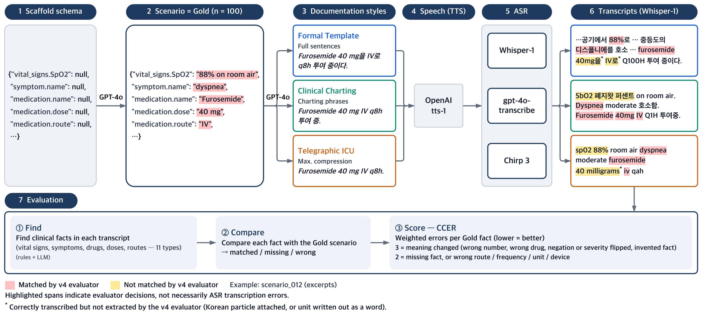

# Korean ICU Nursing Documentation Style Transfer Pipeline

*[한국어 버전은 여기](README.ko.md)*

This project is a study that generates ICU nursing documentation in
multiple Documentation Registers, passes it through speech synthesis (TTS)
and speech recognition (STT), and evaluates clinical information
preservation in the resulting transcripts.

> This is an independent research project developed to support a
> postdoctoral/research position application. It does not use real hospital
> EMR data; the Content Scaffold was designed based on publicly available
> reference material. The pipeline covers ICU nursing note generation,
> speech synthesis, speech recognition, entity-level evaluation, and a
> custom Clinical Critical Error Rate (CCER), implemented end-to-end using
> generative AI.



*Research flow with one example (scenario_012). Highlighted spans show evaluator decisions,
not necessarily ASR errors; \* marks spans that were transcribed correctly but not extracted by
the v4 evaluator (see Sec 3.9).*

Presented as an e-poster at the **KOSMI 2026 Fall Conference (EP 8-6)**:
*Evaluating Clinical Information Preservation Across Documentation Styles in Korean-English
Code-Switched ICU Speech Recognition* -- poster PDF in
[awards-and-posters](https://github.com/jimin-the-ackerman/awards-and-posters).

---

## 1. Research Overview

Korean ICU nursing documentation follows a distinct Documentation Register
that differs from ordinary Korean prose. The same clinical information can
be expressed as a fully grammatical narrative (Formal Template), a
compressed Korean-English mixed charting style (Clinical Charting), or an
extremely compressed real-time style (Telegraphic ICU). This difference in
expression can have different effects on speech recognition performance
and on how much clinical information is preserved.

This project implements and validates, at full scale (100 clinical
scenarios × 3 Documentation Registers = 300 samples):

1. A style-controlled generation pipeline that renders the same clinical
   information (Content Scaffold) into three different Documentation
   Registers.
2. A process that converts the generated documentation into speech (TTS)
   and back into text (STT).
3. An evaluation framework that measures clinical information preservation
   in the transcribed output using Word Error Rate (WER), Entity-level
   Precision/Recall/F1, and Clinical Critical Error Rate (CCER).
4. A pre-registered statistical analysis plan (Friedman/Wilcoxon/mixed-
   effects, WER-CCER association, within-scenario disagreement, and CCER
   weighting-scheme sensitivity).
5. A **Cross-ASR robustness check** (November 2026): the same 300 audio
   files transcribed by three ASR systems (Whisper-1, gpt-4o-transcribe,
   Google Chirp 3) and scored with the unchanged v4 evaluator
   (`docs/cross_asr_spec.md`).
6. A **post hoc evaluator sensitivity analysis (S1)** for Korean particles
   attached to English clinical terms, which the v4 extractor misses
   (`docs/cross_asr_spec.md` Sec 13).

The roles are fixed: the September v4 Whisper-1 analysis is the **primary
analysis**, Cross-ASR is a **robustness check**, and S1 is a **post hoc
sensitivity analysis** that does not replace the primary result.

The evaluation methodology went through four documented revisions
(`docs/design_decisions.md`, `docs/taxonomy_audit.md`,
`docs/v4_style_invariant_extraction_spec.md`) as structural evaluator
biases were discovered and independently audited/corrected -- most notably,
a **style-dependent extraction bias** in which the closed-vocabulary
extractor only recognized English abbreviations, systematically
under-scoring Formal Template (which frequently renders clinical labels
as full Korean words) regardless of actual transcription accuracy. All
results reported below are from the final, bias-corrected pipeline (v4).

---

## 2. Pipeline

```
Reference Analysis
-> Content Scaffold Schema
-> GPT-4o: Structured Clinical Scenario Generation
-> Style Controller
-> GPT-4o: Style-controlled Documentation Generation
-> OpenAI TTS: Speech Synthesis
-> ASR: OpenAI Whisper-1 (primary); gpt-4o-transcribe and Google Chirp 3
   (Cross-ASR robustness check)
-> Entity Extraction (Closed-vocabulary / Open-vocabulary)
-> Entity Matching & Error Type Classification
-> Evaluation (WER / Entity-level P,R,F1 / CCER)
-> Statistical Analysis (Friedman/Wilcoxon/Mixed-effects, WER-CCER
   association, within-scenario disagreement, weight sensitivity)
```

### 2.1 Content Scaffold Generation
Standard nursing documentation forms, SBAR examples, and clinical
abbreviation lists were reviewed to establish the JSON Schema for the
Content Scaffold (`docs/reference_analysis.md`,
`src/scaffold/scaffold_schema.py`). GPT-4o generates structured clinical
scenarios that conform to this schema
(`src/scaffold/generate_scenarios.py`). The Content Scaffold, not the
rendered text, is used as the Gold Standard for evaluation, so that
comparisons across Documentation Registers are not confounded by
extraction differences (`src/entity_extraction/scaffold_as_gold.py`; see
`docs/design_decisions.md` Sec 3).

### 2.2 Style-controlled Documentation Generation
The same Content Scaffold is rendered into three styles -- Formal Template,
Clinical Charting, and Telegraphic ICU -- by instructing GPT-4o. The rules
for each style (sentence compression, Korean-English code-switching,
charting-style verb endings, etc.) are grounded in the reference analysis
(`src/style_controller/style_controller.py`,
`src/generation/generate_notes.py`).

### 2.3 Speech Synthesis & Recognition
The generated nursing documentation text is synthesized into speech using
OpenAI TTS (`src/tts/synthesize_speech.py`) and transcribed back into text
using the OpenAI Whisper API (`src/stt/transcribe.py`). A single voice is
fixed across all samples to keep speaker identity as a controlled
variable.

For the Cross-ASR robustness check, the same 300 audio files were
additionally transcribed with `gpt-4o-transcribe` (OpenAI) and `chirp_3`
(Google Speech-to-Text V2), with no prompts, vocabulary boosting or term
lists (`src/cross_asr/transcribe.py`, `configs/cross_asr.yaml`). Condition A
(Korean specified) is primary; Condition B (language not specified / auto)
is exploratory. CLOVA Speech was trialled and excluded before the main
analysis (romanized Korean output; see `docs/cross_asr_spec.md` Sec 11.1).

### 2.4 Entity Extraction
Clinical information is extracted from the transcripts in two tracks,
covering 11 entity types confirmed independently of observed error
patterns (`docs/taxonomy_audit.md` Sec 5):

- **Closed-vocabulary entities** (Route, Frequency, Device, Dose, Vital
  Sign): extracted via dictionary/regex rules built from the standard
  abbreviation list identified in the reference analysis
  (`src/entity_extraction/closed_vocab_extractor.py`). As of v4, this
  extractor is **style-invariant**: each entity is recognized via a
  canonical `surface form -> concept/value -> comparison` pipeline
  covering English abbreviations, English full forms, Korean full forms,
  and a small set of conventional phonetic transliterations, rather than
  English abbreviations only. `medication_dose` extraction additionally
  applies an entity-ownership hierarchy (candidate detection ->
  exclusion by more specific ownership such as vital-sign or
  intake/output values -> medication-administration-context confirmation)
  to avoid mis-attributing unrelated numbers as drug doses. See
  `docs/v4_style_invariant_extraction_spec.md` for the full specification
  and audit trail.
- **Open-vocabulary entities** (Symptom, Clinical Status, Medication
  Identity, Intervention, Intake/Output, Notification): extracted via
  Claude's structured output, since these expressions are too free-form
  for rule-based extraction (`src/entity_extraction/open_vocab_extractor.py`).

### 2.5 Entity Matching & Error Classification
Entities extracted from the Whisper transcript are compared against the
Gold Standard (the Content Scaffold) to determine whether each piece of
clinical information was preserved.

- Closed-vocabulary: matched via rule-based comparison of normalized
  values (`src/matching/entity_matcher.py`).
- Open-vocabulary: matched via Claude, which reviews the Gold and Whisper
  entity lists together and performs semantic matching, including a
  stricter look-alike/sound-alike safeguard for medication identity
  grounded in the ISMP Confused Drug Names list
  (`src/matching/semantic_matcher.py`).

Match results are classified as Matched / Omission / Numeric Error /
Route Error / Frequency Error / Medication Identity Error / Negation Flip
/ Severity Shift / Hallucination, etc.

### 2.6 Evaluation
Three metrics are used to evaluate the pipeline output:

- **WER** (`src/evaluation/wer_eval.py`): transcription accuracy between
  the Gold Transcript and the Whisper Transcript. Both raw and
  normalized (case/punctuation-insensitive) values are reported.
- **Entity-level Precision/Recall/F1** (`src/evaluation/entity_eval.py`):
  clinical information preservation rate of the Whisper output relative
  to the Content Scaffold.
- **Clinical Critical Error Rate (CCER)** (`src/evaluation/ccer_eval.py`):
  a normalized score that weights each error type by its potential
  clinical risk. The weighting scheme conceptually references the
  patient-safety philosophy of NCC MERP (and, for medication identity
  specifically, the ISMP Confused Drug Names list) and was designed by
  the researcher into three tiers (high / medium / low); this weighting
  choice was stress-tested against 5 pre-registered alternative schemes
  (Sec 3.5 below).

### 2.7 Statistical Analysis
A pre-registered analysis plan (`docs/statistical_analysis_plan.md`,
frozen before running) covers: Friedman test with Kendall's W, Holm-
corrected Wilcoxon pairwise comparisons, a mixed-effects model
(`src/analysis/statistical_tests.py`); scenario-level cluster-bootstrap
WER-CCER Spearman correlation (`src/analysis/sap1_wer_ccer_spearman.py`);
within-scenario ranking disagreement (`src/analysis/sap2_within_scenario_disagreement.py`);
CCER weighting-scheme sensitivity across 5 pre-specified schemes
(`src/analysis/sap3_weight_sensitivity.py`); and entity-type error rates
(`src/analysis/sap4_error_profile_final.py`).

---

## 3. Results (Final, v4, n=100 scenarios / 300 samples)

Full results: [`results/full_100_v4/`](results/full_100_v4/).

### 3.1 Word Error Rate (normalized)

| Documentation Register | Mean WER |
|---|---|
| Formal Template | 0.3038 |
| Clinical Charting | 0.4517 |
| Telegraphic ICU | 0.5640 |

### 3.2 Entity-level Evaluation

| Documentation Register | Precision | Recall | F1 |
|---|---|---|---|
| Formal Template | 0.8432 | 0.6728 | 0.7484 |
| Clinical Charting | 0.7665 | 0.5406 | 0.6341 |
| Telegraphic ICU | 0.7995 | 0.4933 | 0.6101 |

### 3.3 Clinical Critical Error Rate

| Documentation Register | CCER (lower is better) |
|---|---|
| Formal Template | 0.8417 |
| Clinical Charting | 1.1682 |
| Telegraphic ICU | 1.2134 |

### 3.4 Statistical Significance

Friedman test: chi-squared = 78.12, Kendall's W = 0.391, p = 1.09 x 10^-17.
Holm-corrected Wilcoxon signed-rank: Formal Template differs significantly
from both other styles (p_holm ~= 1.3 x 10^-11 and 3.3 x 10^-12, respectively);
Clinical Charting and Telegraphic ICU are not significantly different from
each other (p_holm = 0.217). A mixed-effects model (`CCER ~ style +
(1|scenario)`) confirms both style coefficients are significant at
p < 0.0001. The finding that Formal Template is CCER-best held across all
5 pre-registered CCER weighting schemes (`docs/statistical_analysis_plan.md`
Sec 3).

### 3.5 Key Finding

By every metric -- WER, Entity-level F1, **and** CCER -- Formal Template now
performs **best**, and Telegraphic ICU performs worst. This is a striking
reversal from an earlier, methodologically confounded version of this
pipeline (v3), which had found the opposite: Formal Template ranked best
by WER but *worst* by CCER, suggesting that fully grammatical narrative
sentences improved raw transcription accuracy while causing Whisper to
lose more clinical information.

That earlier "reversal" finding did **not** survive a full evaluator
audit. Two independent structural biases inflated Formal Template's error
counts without reflecting any real loss of clinical information:

1. **Style-dependent extraction bias**: the closed-vocabulary extractor
   only recognized English abbreviations (`BP`, `HR`, `IV`, `q4h`, ...).
   Formal Template frequently renders the same clinical facts as full
   Korean words (`혈압`, `심박수`, `정맥으로`, `매 4시간마다`), which the
   original extractor could not recognize at all -- regardless of whether
   Whisper transcribed them correctly. This alone drove Formal Template's
   vital-sign recognition rate from 0% to 100% once fixed.
2. **Gold/Whisper value-format asymmetry**: even after fixing (1), the
   Content Scaffold's Gold values retained their original units (e.g.
   `"120 bpm"`) while the Whisper-side extractor only ever captured the
   bare number (`"120"`). This caused a false "numeric error" even when
   Whisper transcribed the number perfectly -- a bug present since the
   pipeline's earliest version, invisible until (1) was fixed and Formal
   Template's labels started matching for the first time.

Both were audited and corrected with real-data verification (recovery
rate, no-regression checks, and false-positive scans) rather than
patched to fit the desired outcome; see `docs/v4_style_invariant_extraction_spec.md`
for the full specification, grounding, and audit trail. The correct,
bias-free conclusion is that WER, Entity-level F1, and CCER are broadly
consistent for this pilot: more grammatical, fully-spelled-out
documentation is both easier for Whisper to transcribe accurately *and*
better at preserving clinical information -- the opposite of what a
naive, English-only evaluator would have concluded.

This project's methodological contribution is therefore less about the
specific ranking of the three styles, and more about demonstrating that
building a clinically-informed evaluation metric (CCER) does not by
itself guarantee freedom from evaluator bias -- the entity extraction
layer underneath it must be audited with the same rigor as the metric
itself.

### 3.6 Macro-CCER: Is Formal Template's Advantage Uniform?

The primary (micro-averaged) CCER above weights each entity type by its
frequency in the Gold Standard -- vital signs, present five times per
scenario, account for ~35% of all Gold entities (500 of 1415). A
post-hoc sensitivity analysis (added *after* seeing the aggregate
results, and documented as such in `docs/statistical_analysis_plan.md`)
checked whether Formal Template's advantage was explained by this
frequency imbalance by computing a **macro-CCER**: an entity-type-specific
CCER averaged with equal weight across all 11 entity types regardless of
frequency.

| Register | Micro-CCER | Macro-CCER | Entity types won (of 11) |
|---|---|---|---|
| Formal Template | 0.8417 | **0.8021** | **7** |
| Clinical Charting | 1.1682 | 0.8469 | 3 |
| Telegraphic ICU | 1.2134 | 0.9563 | 1 |

The ranking held under macro-averaging, so Formal Template's advantage
is not purely a vital-sign-frequency artifact -- but the margin narrowed
substantially (from a ~0.33-0.37 micro-CCER gap to a ~0.04-0.15
macro-CCER gap), and the advantage is **not uniform**: Formal Template
had the lowest entity-type CCER in 7 of 11 types (one of them a tie with
Clinical Charting, `medication_identity`; dramatically so for
`vital_sign`), but *underperformed* Clinical Charting on `device`,
`dose`, and `route` -- the entity types describing medication
administration and physical equipment -- and was highest on `symptom`.
This motivated the exploratory follow-up in Section 3.7. Most of the
`dose`/`route` gap was later traced to an evaluator effect (Section 3.9).

### 3.7 Exploratory Follow-up: An Entity-Informed Hybrid Register

The entity-dependent pattern above raises a natural design question:
rather than applying one register uniformly to an entire note, could
combining registers at the level of individual clinical facts recover
the strengths of each? This question -- and the Hybrid register built to
test it -- was motivated by observing the primary experiment's results,
so it is treated throughout as an **exploratory follow-up**, not a
confirmatory test (full design, pre-registered hypotheses, and
manipulation-check plan frozen *before* any Hybrid data was generated:
`docs/hybrid_followup_spec.md`).

**Design**: Hybrid renders vital signs, symptom, clinical status,
intervention, notification, and intake/output in the Formal Template
style, and the medication event (name+dose+route+frequency, rendered as
one grammatical unit per the existing Medication Expression Rule) plus
device/oxygen-support in the Clinical Charting style -- while strictly
preserving the Content Scaffold's natural fact order (an earlier draft
that grouped Formal-style facts before Clinical-style facts was
rejected specifically because it would confound register with
information order). Frequency's inclusion in the Clinical block is
grammatical necessity, not because Clinical outperformed Formal on
frequency alone (it did not: 0.687 vs. 1.192).

A deterministic **manipulation check** (no additional API calls) run on
all 100 generated Hybrid notes before speech synthesis confirmed the
intended register was actually produced: 314/344 (91.3%) of
route/frequency/device instances rendered in English-abbreviated form,
and 488/488 (100.0%) of vital-sign instances rendered in Korean
full-form, as intended. This result was recorded as-is and did not
prompt re-tuning of the generation prompt.

**Results** (n=100 scenarios, same underlying scaffolds as the primary
experiment):

| Register | nWER | Entity F1 | Micro-CCER | Macro-CCER |
|---|---|---|---|---|
| **Hybrid** | 0.3342 | **0.8084** | **0.6664** | **0.6340** |
| Formal Template | 0.3038 | 0.7484 | 0.8417 | 0.8021 |
| Clinical Charting | 0.4517 | 0.6341 | 1.1682 | 0.8469 |
| Telegraphic ICU | 0.5640 | 0.6101 | 1.2134 | 0.9563 |

Hybrid achieved the best Entity F1, micro-CCER, and macro-CCER of all
four registers -- a 21% reduction in micro-CCER relative to Formal
Template (0.842 -> 0.666), confirmed scenario-by-scenario with a paired
Wilcoxon signed-rank test against Formal Template (the primary
inferential comparison, since both share the same 100 scaffolds):
**W = 1070.00, p = 7.07 x 10^-6** (68/100 scenarios improved, 27
worsened, 5 tied).

Entity-level results confirmed the motivating pattern: `device`, `dose`,
and `route` all improved substantially relative to Formal Template,
moving toward -- and for `dose`, past -- Clinical Charting's level.
However, `vital_sign` and several other Formal-block entity types *also*
improved despite an *unchanged* rendering rule between Formal and
Hybrid, suggesting part of the overall gain may reflect ordinary
TTS/STT run-to-run variation rather than the register redesign alone --
a caveat that does not apply to `device`/`dose`/`route`, whose
rendering rule did change. Most importantly, **`frequency` got worse
under Hybrid (0.687 -> 1.343) than under either original register**,
including Clinical Charting's own already-worse frequency performance
(1.192) -- exactly the a priori-documented risk of forcing a
linguistically coupled quartet of facts (medication name/dose/route/
frequency) across two different registers. This is reported as a
genuine, informative negative finding: entity-specific advantages
observed descriptively do not automatically compose into a uniformly
superior mixed-register note.

> **Update (November 2026).** Under the post hoc particle-handling
> sensitivity analysis (Section 3.9), the Hybrid advantage over Formal
> Template is not present (micro-CCER 0.674 vs 0.675; macro-CCER 0.645 vs
> 0.598; pooled values, not tested). Hybrid rendered medication facts in
> the Clinical style ("40 mg IV") and so avoided an extraction gap that
> only affected Formal Template's "40mg을", "IV로". Most of the Hybrid gain is
> therefore more likely an evaluator effect than better transcription.

### 3.8 Cross-ASR Robustness Check (November 2026)

Same 300 audio files, same scaffolds, unchanged v4 evaluator; all three
systems evaluated in the same run, including a re-evaluation of the
September Whisper-1 transcripts (Condition A, Korean specified, n = 100
scenarios). Full protocol and run notes: `docs/cross_asr_spec.md`;
results: `results/cross_asr/`.

| ASR | Style | nWER | Entity F1 | Micro-CCER | Macro-CCER |
|---|---|---|---|---|---|
| Whisper-1\* | Formal | **0.304** | **0.750** | **0.837** | **0.785** |
| | Clinical | 0.452 | 0.627 | 1.180 | 0.864 |
| | Telegraphic | 0.564 | 0.617 | 1.194 | 0.917 |
| gpt-4o-transcribe | Formal | **0.246** | **0.822** | **0.636** | 0.671 |
| | Clinical | 0.277 | 0.722 | 0.925 | 0.643 |
| | Telegraphic | 0.360 | 0.770 | 0.796 | **0.559** |
| Chirp 3 | Formal | **0.155** | **0.813** | **0.672** | 0.685 |
| | Clinical | 0.243 | 0.745 | 0.845 | **0.560** |
| | Telegraphic | 0.305 | 0.768 | 0.785 | 0.582 |

\*Same transcripts as the primary analysis, re-evaluated in November 2026;
pooled CCER differed by at most 0.02 from the September run, with the same
style ranking (evaluation-LLM run-to-run variation; temperature not set).
Bold = best within each system.

| ASR (v4, n = 100) | Friedman chi-sq (W) | F vs C (Holm p) | F vs T (Holm p) | C vs T (Holm p) |
|---|---|---|---|---|
| Whisper-1\* | 75.7 (0.38) | 9.8e-12 | 5.0e-12 | 0.72 |
| gpt-4o-transcribe | 35.5 (0.18) | 6.6e-9 | 0.0017 | 0.0095 (T lower) |
| Chirp 3 | 8.1 (0.04) | 5.9e-4 | **0.066** | 0.24 |

- **Formal Template had the lowest nWER, highest Entity F1 and lowest
  micro-CCER with all three systems.** The order of Clinical Charting
  and Telegraphic ICU varied by system.
- Under v4 the Formal advantage was not significant for Chirp 3 Formal vs
  Telegraphic (Holm p = 0.066), and under **macro-CCER Formal ranked last
  for gpt-4o-transcribe and Chirp 3** -- see Section 3.9 for why.
- Condition B (language not specified, exploratory) gave the same
  micro-CCER pattern (Formal lowest for all three systems).
- Excluding the two scenarios with suspected TTS defects (007, 063;
  `docs/cross_asr_spec.md` Sec 12.3) does not change any conclusion.

### 3.9 Post hoc Evaluator Sensitivity Analysis S1: Korean Particle Attachment

The notation diagnostics of the Cross-ASR study found correctly
transcribed English terms followed by a Korean particle -- e.g. "40mg**을**",
"IV**로**", "nasal cannula**를**" -- that the v4 closed-vocabulary
extractor misses, because Python's `\b` treats Hangul as word characters.
S1 changes only the word-boundary condition of 41 closed-vocabulary
patterns to also accept 27 Korean particles (the particle is not part of
the extracted value); open-vocabulary matches are reused unchanged.
Designed after viewing results, so it is reported as a **post hoc
sensitivity analysis**; v4 remains primary (`docs/cross_asr_spec.md`
Sec 13, 13.1; no API call).

| ASR | Formal micro-CCER (v4 -> S1) | Formal macro-CCER (v4 -> S1) | Macro ranking (v4 -> S1) |
|---|---|---|---|
| Whisper-1 (Sep, primary run) | 0.842 -> 0.675 | 0.802 -> 0.598 | F < C < T -> F < C < T |
| Whisper-1\* (Nov) | 0.837 -> 0.670 | 0.785 -> 0.581 | F < C < T -> F < C < T |
| gpt-4o-transcribe | 0.636 -> 0.466 | 0.671 -> 0.455 | T < C < **F** -> **F** < T < C |
| Chirp 3 | 0.672 -> 0.455 | 0.685 -> 0.419 | C < T < **F** -> **F** < C < T |

- S1 changed **only Formal Template**: Clinical Charting and Telegraphic
  ICU changed by 0.005 or less (micro and macro).
- Under S1, Formal differed from both other styles for every system
  (Holm p < 1e-8); Kendall's W rose (Sep Whisper-1 0.39 -> 0.51,
  gpt-4o-transcribe 0.18 -> 0.40, Chirp 3 0.04 -> 0.33).
- Entity level (Sep Whisper-1, Formal v4 -> S1; Clinical Charting in
  parentheses): `dose` 1.820 -> **0.640** (1.040; ranking reversed),
  `route` 1.770 -> 1.090 (1.010), `device` 1.618 -> 1.309 (0.890; the
  remaining gap likely involves Korean transliterations such as "폴리
  캐테터", which are outside S1's scope).
- Manual review (Condition A; transcript and scaffold, no audio): a
  stratified sample of 30 omission -> matched changes were all valid
  matches; a 40-record side-effect audit found 24 residual evaluator
  artifacts (e.g. duplicate IV mentions, oxygen flow or fluid volume
  read as a dose). **S1 values therefore still contain residual
  evaluator artifacts and are not reported as corrected values.**
- Macro-CCER under S1 and the Hybrid S1 check were added for the KOSMI
  poster (`src/cross_asr/kosmi2026_tables.py`,
  `results/cross_asr/kosmi2026_tables/`, spec Sec 13.2).

### 3.10 Overall Conclusion

1. **Style result.** Formal Template had the lowest micro-CCER (and nWER,
   highest Entity F1) with all three ASR systems, and this advantage
   persisted -- and widened -- after the post hoc particle correction.
2. **Evaluator result.** How the evaluator handled Korean-English
   expressions changed the conclusions twice: the v3 -> v4 redesign
   (Korean labels, value formats) reversed the overall style ranking
   (Sec 3.5), and particle handling (S1) reversed the `dose` ranking,
   the macro-CCER ranking for two systems, and the Hybrid advantage.
   Clinically weighted evaluation of Korean-English code-switched ASR
   needs style-invariant extraction and an evaluator validated against
   human annotation.

**Limitations.** LLM-generated notes and single-voice TTS speech, not real
ICU speech; entity taxonomy and severity weights based on external
references without clinician review; evaluator decisions (including the
LLM-based open-vocabulary matching) not validated against human
annotation.

**Future work.** Clinician-reviewed scenarios, entity definitions and
weights with real ICU speech; a human-validated code-switching-aware
evaluator; then CCER-informed ASR fine-tuning.

---

## 4. Repository Structure

```
korean-icu-ccer-pilot/
├── configs/
│   └── config.yaml              # Experiment configuration (n_scenarios, results_dir, etc.)
├── docs/
│   ├── reference_analysis.md    # Reference material analysis
│   ├── design_decisions.md      # Design changes during implementation
│   ├── limitations.md           # Limitations of the study
│   ├── taxonomy_audit.md        # v3: independent CCER taxonomy audit & freeze
│   ├── v4_style_invariant_extraction_spec.md  # v4: style-bias audit, spec, freeze
│   ├── statistical_analysis_plan.md           # Pre-registered SAP (frozen)
│   ├── hybrid_followup_spec.md                # Exploratory Hybrid register design (frozen)
│   ├── cross_asr_spec.md                      # Cross-ASR protocol, run notes, S1 (Sec 13)
│   ├── figures/research_flow.png              # Research flow figure (KOSMI 2026)
│   └── full_run_execution_order.md            # Locked execution order for scale-ups
├── data/
│   ├── scenarios/                # Content Scaffold (GPT-4o generated)
│   ├── generated_text/           # Style-controlled Gold Transcripts (incl. Hybrid)
│   ├── audio/                    # TTS audio files (not tracked in git)
│   ├── stt_transcripts/          # Whisper transcription results
│   ├── entities/                 # Entity extraction/matching results
│   └── cross_asr/<condition>/    # Cross-ASR transcripts, entities, run logs
├── src/
│   ├── pipeline_utils.py          # Skip-by-default safety mechanism (RunLog, --overwrite)
│   ├── scaffold/                  # Content Scaffold schema and generation
│   ├── style_controller/          # Documentation Register rules (incl. Hybrid)
│   ├── generation/                # GPT-4o documentation generation
│   ├── tts/                       # Speech synthesis
│   ├── stt/                       # Speech recognition
│   ├── entity_extraction/         # Closed/open-vocabulary extraction
│   ├── matching/                  # Entity matching, semantic matching
│   ├── evaluation/                # WER, entity evaluation, CCER
│   ├── analysis/                  # Error profile, statistical tests, SAP 1-5,
│   │                                 hybrid_followup, hybrid_manipulation_check
│   └── cross_asr/                 # Cross-ASR transcription, evaluation, analysis,
│                                     notation diagnostics, S1, KOSMI tables
├── results/
│   ├── pilot_15/                  # v1/v2/v3 checkpoints (15-sample pilot, preserved)
│   ├── full_50/                   # 50-scenario checkpoint (preserved)
│   ├── full_100/                  # v3 (pre-v4-fix) 100-scenario checkpoint (preserved)
│   ├── full_100_v4/               # FINAL results, 3-register primary analysis (bias-corrected)
│   ├── hybrid_followup/           # Exploratory Hybrid register results (separate from full_100_v4/)
│   ├── cross_asr/                 # Cross-ASR analysis (analysis_prelim_condA = final), notation
│   │                                 diagnostics, sensitivity_ko_particle (S1), kosmi2026_tables
│   └── _env/                      # Environment snapshot for the Cross-ASR runs
└── tests/                          # Unit tests
```

---

## 5. Reproduction

### 5.1 Environment Setup

```bash
python3 -m venv venv
source venv/bin/activate
pip install -r requirements.txt
cp .env.example .env   # fill in OPENAI_API_KEY, ANTHROPIC_API_KEY
```

### 5.2 Full Pipeline Execution Order

All generation/extraction/matching scripts are idempotent by default:
re-running any step skips samples whose output already exists, and only
processes what's missing (`src/pipeline_utils.py`). Pass `--overwrite` to
force regeneration of a step. This makes scale-ups (e.g. 5 -> 50 -> 100
scenarios) safe to run without risking already-computed results -- see
`docs/full_run_execution_order.md` for the full checklist used for this
project's own scale-ups.

```bash
# 1. Generate Content Scaffolds (GPT-4o)
python3 -m src.scaffold.generate_scenarios

# 2. Generate style-controlled documentation (GPT-4o)
python3 -m src.generation.generate_notes

# 3. Speech synthesis (OpenAI TTS)
python3 -m src.tts.synthesize_speech

# 4. Speech recognition (OpenAI Whisper)
python3 -m src.stt.transcribe

# 5. Entity extraction (no API calls: closed-vocab is regex-based;
#    open-vocab calls Claude)
python3 -m src.entity_extraction.run_closed_vocab_extraction
python3 -m src.entity_extraction.run_open_vocab_extraction

# 6. Entity matching (closed-vocab: rule-based, no API; open-vocab: Claude)
python3 -m src.matching.run_closed_vocab_matching
python3 -m src.matching.run_semantic_matching

# 7. Evaluation (WER, Entity-level P/R/F1, CCER, Error Profile) - no API calls
python3 -m src.evaluation.wer_eval
python3 -m src.evaluation.entity_eval
python3 -m src.evaluation.ccer_eval
python3 -m src.analysis.error_profile --output-dir results/full_100_v4

# 8. Statistical analysis (per docs/statistical_analysis_plan.md) - no API calls
python3 -m src.analysis.statistical_tests --results-dir results/full_100_v4
python3 -m src.analysis.sap1_wer_ccer_spearman --results-dir results/full_100_v4
python3 -m src.analysis.sap2_within_scenario_disagreement --results-dir results/full_100_v4
python3 -m src.analysis.sap3_weight_sensitivity --output-dir results/full_100_v4
python3 -m src.analysis.sap4_error_profile_final --output-dir results/full_100_v4
```

### 5.3 Scaling Up

Change `experiment.n_scenarios` in `configs/config.yaml` (and, if you want
results kept in a separate directory, `paths.results_dir`), then re-run
the same sequence above. Because every step defaults to skip-existing,
already-computed scenarios (e.g. the first 100) are left untouched and
only the newly-added ones are processed -- no separate code changes are
needed. See `docs/full_run_execution_order.md` for the exact checklist
(pre-flight checks, integrity verification, and non-goals) used when
this project scaled from 5 -> 50 -> 100 scenarios.

### 5.4 Cross-ASR Robustness Check and S1

Settings are in `configs/cross_asr.yaml`; transcription needs
`OPENAI_API_KEY` and Google Application Default Credentials (Chirp 3),
evaluation needs `ANTHROPIC_API_KEY`. Exact arguments, run order and
stopping rules are documented in `docs/cross_asr_spec.md` (Sec 3-13) and
each module's `--help`.

```bash
python3 -m src.cross_asr.manifest              # audio manifest and pilot set
python3 -m src.cross_asr.transcribe            # per-condition transcription (API)
python3 -m src.cross_asr.evaluate              # CCER v4 evaluation per condition (API)
python3 -m src.cross_asr.analysis              # pooled CCER, Delta, Friedman/Wilcoxon (no API)
python3 -m src.cross_asr.notation_diagnostics  # notation counts and case review (no API)
python3 -m src.cross_asr.sensitivity_ko_particle --run   # S1 (no API)
python3 -m src.cross_asr.kosmi2026_tables      # KOSMI poster tables (no API)
```

### 5.5 Tests

```bash
pytest tests/ -q
```

---

## 6. Related Documents

- [`docs/reference_analysis.md`](docs/reference_analysis.md): analysis of
  reference material underlying the Content Scaffold Schema and Style
  Controller rules
- [`docs/design_decisions.md`](docs/design_decisions.md): design changes
  made during implementation relative to the original proposal
- [`docs/limitations.md`](docs/limitations.md): limitations of the study,
  including residual (non-style-bias) parsing gaps left unresolved by
  design
- [`docs/taxonomy_audit.md`](docs/taxonomy_audit.md): v3 -- independent,
  results-blind audit and freeze of the 11-category CCER entity taxonomy
- [`docs/v4_style_invariant_extraction_spec.md`](docs/v4_style_invariant_extraction_spec.md):
  v4 -- audit, specification, and freeze of the style-invariant
  closed-vocabulary extraction fix described in Sec 3.5 above
- [`docs/statistical_analysis_plan.md`](docs/statistical_analysis_plan.md):
  pre-registered statistical analysis plan (frozen before execution),
  including the post-hoc Macro-CCER addition described in Sec 3.6
- [`docs/hybrid_followup_spec.md`](docs/hybrid_followup_spec.md):
  design specification (block mapping, pre-registered hypotheses,
  manipulation-check plan) for the exploratory Hybrid register
  described in Sec 3.7, frozen before any Hybrid data was generated
- [`docs/full_run_execution_order.md`](docs/full_run_execution_order.md):
  locked execution checklist used for scaling the pilot from 5 to 100
  scenarios without risking already-computed results
- [`docs/cross_asr_spec.md`](docs/cross_asr_spec.md): Cross-ASR protocol
  (frozen 2026-11-03), revisions, run notes, notation diagnostics, the
  post hoc S1 analysis and its manual review (Sec 13, 13.1), and the KOSMI
  poster recomputations (Sec 13.2)

---

## 7. Presentations

- **KOSMI 2026 Fall Conference**, e-poster EP 8-6 -- *Evaluating Clinical
  Information Preservation Across Documentation Styles in Korean-English
  Code-Switched ICU Speech Recognition* (Jimin Kim). Poster PDF:
  [awards-and-posters](https://github.com/jimin-the-ackerman/awards-and-posters).

---

## 8. Author

Jimin (jimin-the-ackerman)
